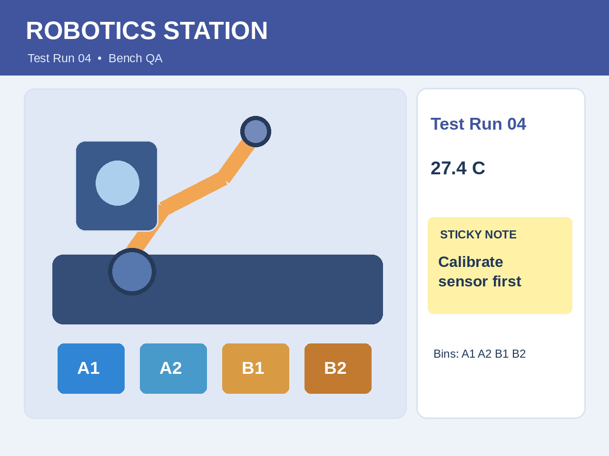
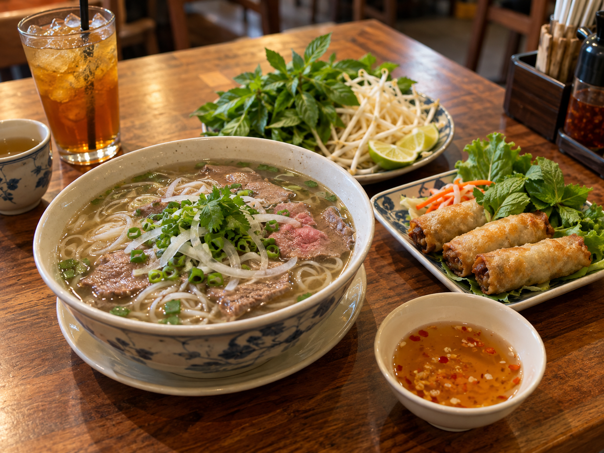

# Qwen3.8-27B on Kaggle TPU v5e-8

**Original BF16 · Text + Vision · JAX / MaxText · Reproducible engineering examples**

> 🌐 Language / Ngôn ngữ: **English** | [Tiếng Việt](README.vi.md)

[](https://github.com/dangkhoa2016/Qwen3.8-27B-On-Kaggle-TPU-v5e8/actions/workflows/cpu-acceptance.yml)
[](LICENSE)
[](MODEL_LICENSE.md)


This project explores how to run **Qwen3.8-27B BF16 from the [Kaggle model mirror](https://www.kaggle.com/models/dangkhoa2016/qwen-qwen3-8-27b)**, on **eight Kaggle TPU v5e devices** using JAX and patched MaxText. In the tested environment the notebook loads the attached Kaggle checkpoint—not directly from a Hugging Face URL. The repository combines experimental inference evidence, the Full19 Text+Vision exercise, a versioned notebook source, a FastAPI/Vue playground and reproducible evaluation methods.

The goal is to share **practical lessons in large-model TPU execution**—especially multimodal fusion, AOT prefill, input integrity, performance measurement and honest interpretation of model answers.

## What you can explore

| Learning path | What you get | Where to begin |
|---|---|---|
| Understand TPU multimodal inference | Visual-to-token pipeline, MRoPE and JAX/XLA checks | [Architecture](docs/ARCHITECTURE.md) |
| Try the API without TPU | Local FastAPI + Vue CDN mock and test suite | [CPU quickstart](#try-the-cpu-playground) |
| Study the actual input examples | 16 hashed images and 19 case definitions | [Example gallery](examples/README.md) |
| Reproduce the TPU run | Original BF16 model, offline support and notebook setup | [Step-by-step guide](docs/REPRODUCIBILITY.md) |
| Evaluate model quality | OCR, image reasoning, exact outputs and observed errors | [Evaluation guide](docs/ACCEPTANCE.md) |
| Interpret speed fairly | One measured run, cold/warm methodology and gaps | [Performance guide](docs/PERFORMANCE-ANALYSIS.md) |

## Explore the actual input images

These are **model inputs**, not generated output images from Qwen. The photography collection includes AI-created illustrations that are clearly labeled as such.

| Street crossing | Illustrated 3D scene | Vietnamese meal |
|---|---|---|
|  |  |  |
| Street-signal and spatial reasoning | Objects and scene relationships | Food and object recognition |

Find the exact case prompts, dimensions and SHA256 in the [16-image manifest](examples/assets_manifest.json) and [examples guide](examples/README.md).

## Evidence from a real TPU run

On **27 October 2026**, an experimental Split-Vision runner performed the Full19 exercise on real Kaggle TPU v5e-8 hardware:

| Measurement | Recorded result |
|---|---|
| Model | Original BF16 27B; **18 safetensors shards**, 1,199 tensor entries |
| TPU runtime | Eight v5e devices, one MaxEngine and one parameter load |
| Cases | **3 Text + 2 OCR + 6 Rich Vision + 8 Photography = 19** |
| Automated execution | **19/19 case completions with EOS** |
| Focused checks | Text 3/3; numeric OCR **731**, **482**; Rich Vision **55/55** keyword checks |
| Full run elapsed time | **1,160.844 seconds = 19 min 20.844 s** |

**What this means:** the model ran and generated those responses. It does **not** mean 19/19 answers were factually perfect or that the HTTP TPU backend has been benchmarked. In the archived outputs the model misread an invoice's **8% / $69.28 tax** as **5% / $66.28**, and described **114 vs 31** as “nearly double.” The raw errors are retained so others can learn from them.

Read [the Full19 evidence](docs/FULL19-EVIDENCE.md), [model-behavior case studies](docs/FAILURE-ANALYSIS.md) and [performance interpretation](docs/PERFORMANCE-ANALYSIS.md).

## Try the CPU playground

You can explore the request/response behavior without a TPU or model checkpoint. From the repository root:

```bash
python -m pip install -r requirements-cpu.txt
QWEN38_BACKEND=mock python -m uvicorn api.app:app --host 127.0.0.1 --port 8090
```

Open **http://127.0.0.1:8090**. The interface clearly says **MOCK BACKEND · NO MODEL LOADED**; its answers are not inference from Qwen3.8-27B.

To run the checks:

```bash
python -m pytest -q tests
npm ci
npx playwright install chromium
npm run test:e2e
```

The latest verified source passed **36 Python tests (one skipped)** and **two Playwright browser tests**. See [API documentation](api/README.md) for routes and validation behavior.

## Run the original BF16 model on TPU

The [Full19 notebook source](notebooks/kaggle-tpu-v5e8-production-showcase.ipynb) documents one 27B engine, image preprocessing at **512 × 384**, **320-token prefill**, **768-token target**, native JAX/XLA sharding checks and case-by-case token evidence.

The model and runtime-support files are **separate Kaggle attachments**. Some resources remain **Private and require authorized access** during distribution/license review. Follow [the reproducibility guide](docs/REPRODUCIBILITY.md) and [offline-resource inventory](docs/OFFLINE-SUPPORT.md); do not mix Dataset manifests across notebook versions.

The green-signal crossing image in Git has its own SHA256 and differs from the older image used for the recorded Full19 run. Follow the stable [Full19 notebook source](notebooks/kaggle-tpu-v5e8-production-showcase.ipynb) and [reproduction guide](docs/REPRODUCIBILITY.md); those earlier experimental responses are **not** evidence that the new crossing image has been tested successfully on TPU.

## Architecture and repository map

```text
notebooks/   Full19 BF16 / Split-Vision TPU notebook source
examples/    Input images, manifest SHA256 and prompts
docs/        Architecture, reproduction, evaluation and performance guides
api/         FastAPI CPU playground and separate TPU adapter source
web/         Vue CDN browser playground
tests/       Python and browser regression tests
support/     Pinned runtime-support manifest
```

A central design choice is to **encode images separately, fuse image embeddings with text using MRoPE positions, then run a validated JAX/XLA compiled prefill**. This is explained with a pipeline diagram in [Architecture](docs/ARCHITECTURE.md). The optional HTTP TPU adapter is a separate path and has **not** been qualified by live TPU HTTP requests.

## Reuse, attribution and community

The repository contains **no pretrained Qwen weights**. Project-authored code/docs use [MIT](LICENSE), while the upstream model uses the separately documented [Apache-2.0 license](MODEL_LICENSE.md). Third-party runtime components and input-image distribution require their own review; see [notices](THIRD_PARTY_NOTICES.md).

Ideas, documentation corrections and reproducible regression tests are welcome. Read [Contributing](CONTRIBUTING.md), [Support](SUPPORT.md) and [Security](SECURITY.md). This is an independent engineering demonstration, **not an official Qwen project or endorsement**.

[Project changes](CHANGELOG.md) · [Architecture](docs/ARCHITECTURE.md) · [Reproduction](docs/REPRODUCIBILITY.md) · [Evaluation](docs/ACCEPTANCE.md)
