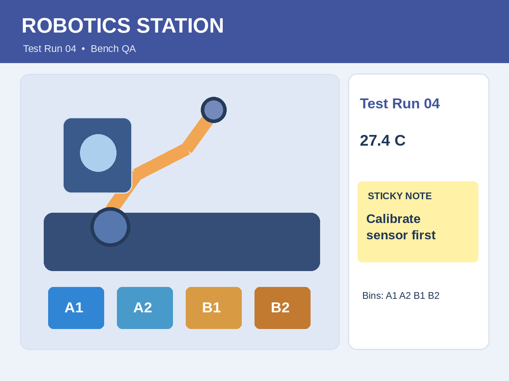

# Qwen3.8-27B trên Kaggle TPU v5e-8

**BF16 nguyên gốc · Text + Vision · JAX / MaxText · Ví dụ kỹ thuật có thể kiểm chứng**

> 🌐 Ngôn ngữ / Language: [English](README.md) | **Tiếng Việt**

[](https://github.com/dangkhoa2016/Qwen3.8-27B-On-Kaggle-TPU-v5e8/actions/workflows/cpu-acceptance.yml)
[](LICENSE)
[](MODEL_LICENSE.vi.md)


Dự án tìm hiểu cách chạy **Qwen3.8-27B BF16 nguyên gốc từ [Kaggle Model mirror](https://www.kaggle.com/models/dangkhoa2016/qwen-qwen3-8-27b)**, trên **tám thiết bị Kaggle TPU v5e** bằng JAX và MaxText đã điều chỉnh. Khi thực thi, notebook nạp checkpoint được attach từ Kaggle, không tải trực tiếp từ đường dẫn Hugging Face. Repository gồm bằng chứng suy luận thực nghiệm, bộ thử Full19 Text+Vision, notebook được quản lý trong Git, FastAPI/Vue Playground và phương pháp đánh giá có thể tái lập.

Mục tiêu là chia sẻ **kiến thức thực tiễn về triển khai mô hình lớn trên TPU**: fusion đa phương thức, AOT prefill, kiểm toàn vẹn input, đo hiệu năng và diễn giải kết quả một cách chính xác.

## Bạn có thể học gì từ dự án?

| Chủ đề | Nội dung hữu ích | Bắt đầu |
|---|---|---|
| Hiểu inference đa phương thức TPU | Từ ảnh tới token, MRoPE và kiểm JAX/XLA | [Kiến trúc](docs/ARCHITECTURE.vi.md) |
| Thử API không cần TPU | FastAPI + Vue CDN mock và tests | [Chạy CPU](#thử-cpu-playground) |
| Khám phá bộ ví dụ | 16 ảnh SHA256 và 19 case | [Bộ ảnh](examples/README.vi.md) |
| Tái lập lượt chạy TPU | Model BF16, support offline, notebook | [Hướng dẫn](docs/REPRODUCIBILITY.vi.md) |
| Đánh giá chất lượng model | OCR, image reasoning, output thật và lỗi | [Đánh giá](docs/ACCEPTANCE.vi.md) |
| Hiểu số đo hiệu năng | Một lượt đo thật, cold/warm và giới hạn | [Hiệu năng](docs/PERFORMANCE-ANALYSIS.vi.md) |

## Khám phá ảnh nguồn thực tế

Đây là **ảnh đầu vào của mô hình**, không phải kết quả hình ảnh do Qwen sinh ra. Nhóm Photography có ảnh minh họa do AI tạo và được ghi nhận rõ.

| Sang đường | Cảnh 3D minh họa | Bữa ăn Việt Nam |
|---|---|---|
|  |  |  |
| Đèn giao thông, quan hệ không gian | Vật thể và bố cục cảnh | Nhận diện món ăn và vật thể |

Prompt, kích thước và SHA256 nằm trong [manifest 16 ảnh](examples/assets_manifest.json) và [hướng dẫn bộ ảnh](examples/README.vi.md).

## Kết quả từ lượt chạy TPU thật

Ngày **27/10/2026**, runner Split-Vision experimental đã thực hiện Full19 trên phần cứng Kaggle TPU v5e-8 thật:

| Chỉ số | Kết quả đã ghi |
|---|---|
| Model | 27B BF16 gốc, **18 shard safetensors**, 1.199 tensor |
| TPU | Tám thiết bị v5e, một MaxEngine, một lần nạp trọng số |
| Case | **3 Text + 2 OCR + 6 Rich Vision + 8 Photography = 19** |
| Hoàn thành tự động | **19/19 case có EOS** |
| Kiểm tra cụ thể | Text 3/3; OCR số **731**, **482**; Rich Vision **55/55** keyword |
| Tổng thời gian | **1.160,844 giây = 19 phút 20,844 giây** |

**Ý nghĩa:** mô hình thật đã sinh output cho các case này. Nhưng **không có nghĩa mọi câu trả lời đều đúng** hoặc HTTP TPU đã được benchmark. Trong output gốc, model đọc thuế invoice **8% / $69.28** thành **5% / $66.28**, và mô tả **114 so với 31** là “gần gấp đôi”. Những lỗi này được giữ nguyên để cộng đồng học hỏi và kiểm chứng.

Xem [bằng chứng Full19](docs/FULL19-EVIDENCE.vi.md), [bài học lỗi](docs/FAILURE-ANALYSIS.vi.md) và [cách đọc benchmark](docs/PERFORMANCE-ANALYSIS.vi.md).

## Thử CPU Playground

Bạn có thể khám phá request/response mà không cần TPU hoặc checkpoint. Từ thư mục gốc:

```bash
python -m pip install -r requirements-cpu.txt
QWEN38_BACKEND=mock python -m uvicorn api.app:app --host 127.0.0.1 --port 8090
```

Mở **http://127.0.0.1:8090**. Giao diện ghi rõ **MOCK BACKEND · NO MODEL LOADED**; câu trả lời không được sinh bởi Qwen3.8-27B.

Chạy kiểm thử:

```bash
python -m pytest -q tests
npm ci
npx playwright install chromium
npm run test:e2e
```

Mã nguồn mới nhất đã được kiểm **36 Python PASS, 1 SKIP** và **hai Playwright PASS**. Xem [tài liệu API](api/README.vi.md) để biết endpoints và điều kiện validate.

## Chạy BF16 gốc trên TPU

[Notebook nguồn Full19](notebooks/kaggle-tpu-v5e8-production-showcase.ipynb) mô tả một engine 27B, ảnh suy luận **512 × 384**, **prefill 320 token**, **target 768 token**, native JAX/XLA sharding checks và evidence token từng case.

Model và runtime support là **hai input Kaggle attach riêng**. Một số tài nguyên đang **Private và cần được cấp quyền truy cập** trong quá trình review giấy phép/phát hành. Xem [hướng dẫn tái lập](docs/REPRODUCIBILITY.vi.md) và [tài nguyên offline](docs/OFFLINE-SUPPORT.vi.md); không ghép nhầm manifest Dataset và notebook.

Ảnh crossing đèn xanh hiện có trong Git mang SHA256 khác ảnh dùng cho kết quả Full19 experimental trước đó. Hãy tham khảo [notebook Full19 trong Git](notebooks/kaggle-tpu-v5e8-production-showcase.ipynb) và [hướng dẫn tái lập](docs/REPRODUCIBILITY.vi.md); các output thực nghiệm trước đây **không** chứng minh ảnh crossing mới đã được nghiệm thu trên TPU.

## Kiến trúc và cấu trúc repository

```text
notebooks/   Notebook Full19 BF16 / Split-Vision TPU
examples/    Ảnh đầu vào, manifest SHA256 và prompts
docs/        Kiến trúc, tái lập, đánh giá và hiệu năng
api/         FastAPI CPU playground và source adapter TPU riêng
web/         Vue CDN browser playground
tests/       Python và browser regression tests
support/     Manifest runtime support đã ghim checksum
```

Một điểm kỹ thuật quan trọng là **mã hóa ảnh riêng, fusion embeddings với text qua MRoPE, rồi dùng JAX/XLA prefill đã được kiểm chứng**. Xem sơ đồ trong [Kiến trúc](docs/ARCHITECTURE.vi.md). Adapter HTTP TPU là đường riêng và **chưa có nghiệm thu request TPU thật**.

## Tái sử dụng, ghi công và đóng góp

Repository **không chứa trọng số Qwen pretrained**. Mã nguồn/tài liệu do dự án viết áp dụng [MIT](LICENSE); model upstream chịu [Apache-2.0](MODEL_LICENSE.vi.md). Runtime dependencies và quyền phân phối ảnh cần kiểm riêng; xem [thông báo bên thứ ba](THIRD_PARTY_NOTICES.vi.md).

Dự án hoan nghênh ý tưởng, sửa tài liệu và regression tests tái lập được. Xem [Đóng góp](CONTRIBUTING.vi.md), [Hỗ trợ](SUPPORT.vi.md), [Bảo mật](SECURITY.vi.md). Đây là dự án nghiên cứu kỹ thuật độc lập, **không phải sản phẩm chính thức hoặc sự bảo trợ của Qwen**.

[Changelog](CHANGELOG.vi.md) · [Kiến trúc](docs/ARCHITECTURE.vi.md) · [Tái lập](docs/REPRODUCIBILITY.vi.md) · [Đánh giá](docs/ACCEPTANCE.vi.md)
