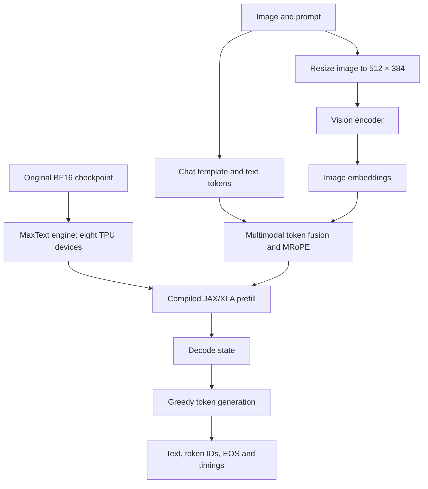

# Architecture: Qwen3.8-27B Text + Vision on TPU v5e-8

> 🌐 Language / Ngôn ngữ: **English** | [Tiếng Việt](ARCHITECTURE.vi.md)

This guide explains how an original **BF16 27B multimodal checkpoint** can be executed with **JAX and patched MaxText on eight Kaggle TPU v5e devices**. It focuses on the components, data movement and validation decisions that readers can adapt to their own large-model TPU experiments.

## At a glance

| Component | Technology | Purpose |
|---|---|---|
| Model | Qwen3.8-27B, original BF16 | Text generation and image understanding |
| Compute | TPU v5e-8, one JAX process | Eight devices, one model engine |
| Runtime | JAX/JAXLIB 0.11.0, patched MaxText | Sharded parameters, prefill and decoding |
| Vision pipeline | Image preprocessing + Split-Vision | Separate visual encoding from decoder prefill |
| Input data | 16 image sources + 3 text prompts | Reproducible Full19 exercise |
| Demo API | FastAPI + Vue CDN | Easy-to-run CPU mock of the HTTP contract |
| Evidence | SHA256, source revision, tokens, EOS, timings | Independently inspectable execution records |

The CPU playground is useful for exploring request formats, **not** a 27B inference server. The TPU notebook is the model-execution example; HTTP serving on TPU remains a separate engineering exercise.

## Inference pipeline



The diagram is a functional overview, not a claim that the optional HTTP adapter has completed the same hardware tests.

### 1. Establish trusted inputs

The checkpoint is attached as the [Kaggle BF16 mirror](https://www.kaggle.com/models/dangkhoa2016/qwen-qwen3-8-27b) (`dangkhoa2016/qwen-qwen3-8-27b`, Transformers/default/v1), **not loaded directly from Hugging Face**. Its index declares **18 safetensors shards**, **1,199 tensor entries** and **55,562,855,904 indexed bytes**. The notebook checks model presence and the offline support manifest before loading the checkpoint.

The support bundle carries runtime dependencies, MaxText patches, JAX helpers, input images and optional compilation-cache candidates. The **48-file manifest** verifies size and SHA256 for every entry. This is a reproducibility aid, not a substitute for runtime compatibility checks.

### 2. Prepare images and multimodal positions

Source images remain at their recorded resolutions. For model execution the notebook converts each image to **512 × 384**, then obtains image-grid metadata, the image-token offset and image embeddings. The text chat template is combined with image markers, and the Qwen-specific **multimodal rotary positional information (MRoPE)** is computed for the fused sequence.

A common integration failure is to fit text tokens within the budget but forget the image-token offset. The pipeline therefore checks the **fused** length, position shape, dtype and embeddings rather than only the plain-text length.

### 3. Compile and run Split-Vision prefill

The reference configuration uses a **320-token prefill**, **768-token maximum target**, and up to **448 decode steps** for Rich Vision and Photography cases. One `MaxEngine` loads the BF16 checkpoint. The Vision encoder runs separately; prefill consumes validated image embeddings and MRoPE metadata.

Native JAX/XLA checks remain enabled. A cached executable may be reused only if the compiler, topology, shapes, sharding and dtypes are compatible. **Matching cache SHA256 proves byte identity, not execution compatibility.**

### 4. Decode and preserve raw results

Greedy decoding advances a single decode state and stops on a real end-of-sequence token (EOS), subject to the configured cap. The exercise records prompt, input digest, generated token IDs, unedited response, elapsed time and errors. Incorrect answers remain in the evidence.

## Two different ways to explore the project

**Run the CPU playground** to experiment with FastAPI routes and browser UI without waiting for a TPU:

```bash
python -m pip install -r requirements-cpu.txt
QWEN38_BACKEND=mock python -m uvicorn api.app:app --host 127.0.0.1 --port 8090
```

**Study or execute the TPU notebook** for actual 27B generation. It requires the correct BF16 Model, a matching support Dataset and eight TPU devices; see [step-by-step reproduction](REPRODUCIBILITY.md).

The optional TPU HTTP adapter in `api/tpu_factory.py` and `api/maxengine_adapter.py` still differs from the notebook in its support path and 256/384 configuration. It is included for API-design study and **has not been demonstrated as live TPU serving**.

## What the evidence establishes

A preserved **27 October 2026 experimental** Split-Vision run completed 19/19 automated cases with EOS in **1,160.844 s**. This is not a general throughput benchmark or proof of perfect image accuracy. The replacement crossing image has a different SHA256, so it requires its **own** TPU evidence before any result can be attributed to that input.

Continue with [Reproducibility](REPRODUCIBILITY.md), [Full19 example cases](FULL19-EVIDENCE.md), [performance measurements](PERFORMANCE-ANALYSIS.md) and [API architecture](../api/TPU-INTEGRATION.md).
