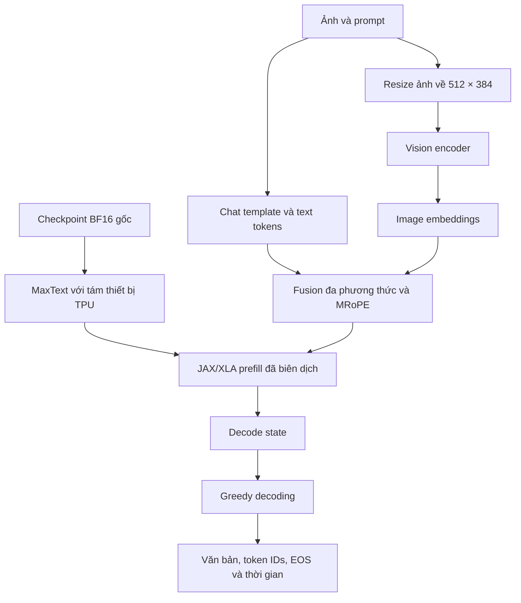

# Kiến trúc: Qwen3.8-27B Text + Vision trên TPU v5e-8

> 🌐 Ngôn ngữ / Language: [English](ARCHITECTURE.md) | **Tiếng Việt**

Tài liệu này giải thích cách thực thi checkpoint đa phương thức **27B BF16 nguyên gốc** bằng **JAX và MaxText đã điều chỉnh trên tám thiết bị Kaggle TPU v5e**. Trọng tâm là kiến trúc, luồng dữ liệu và những nguyên tắc kiểm chứng có thể áp dụng cho các dự án chạy mô hình lớn trên TPU.

## Tổng quan

| Thành phần | Công nghệ | Vai trò |
|---|---|---|
| Mô hình | Qwen3.8-27B, BF16 gốc | Sinh văn bản và hiểu hình ảnh |
| Phần cứng | TPU v5e-8, một tiến trình JAX | Tám thiết bị, một engine |
| Runtime | JAX/JAXLIB 0.11.0, MaxText đã patch | Sharding tham số, prefill và decode |
| Vision | Tiền xử lý ảnh + Split-Vision | Tách mã hóa hình ảnh và decoder prefill |
| Dữ liệu | 16 ảnh + 3 prompt văn bản | Bộ thử nghiệm Full19 có thể đối chiếu |
| API demo | FastAPI + Vue CDN | Minh họa hợp đồng HTTP trên CPU mock |
| Bằng chứng | SHA256, mã nguồn, token, EOS, thời gian | Kiểm chứng kết quả độc lập |

CPU playground chỉ mô phỏng giao tiếp API, **không chạy mô hình 27B**. Notebook TPU mới là đường thực thi model; chạy HTTP thật trên TPU là một bài toán riêng.

## Luồng suy luận



Sơ đồ mô tả kiến trúc chức năng, không khẳng định adapter HTTP TPU đã được nghiệm thu trên phần cứng.

### 1. Kiểm chứng dữ liệu và checkpoint

Checkpoint thực thi được attach từ [bản mirror BF16 trên Kaggle](https://www.kaggle.com/models/dangkhoa2016/qwen-qwen3-8-27b) (`dangkhoa2016/qwen-qwen3-8-27b`, Transformers/default/v1), **không nạp trực tiếp từ Hugging Face**. Index khai báo **18 shard safetensors**, **1.199 tensor** và **55.562.855.904 byte**. Notebook xác minh model và support trước khi nạp trọng số.

Bộ support có patches MaxText, helpers JAX, dependencies, ảnh đầu vào và một số cache biên dịch tùy chọn. Manifest gồm **48 file**, kiểm kích thước và SHA256. Đây là điều kiện toàn vẹn dữ liệu, không tự chứng minh tương thích runtime.

### 2. Tiền xử lý ảnh và vị trí đa phương thức

Ảnh nguồn được giữ cùng kích thước và hash đã ghi. Khi suy luận, ảnh được chuyển về **512 × 384**; pipeline lấy image-grid metadata, số token ảnh và embeddings. Text được đưa qua chat template, ghép image markers và tính **MRoPE** cho chuỗi đã hợp nhất.

Một lỗi tích hợp thường gặp là chỉ kiểm tra độ dài text mà quên image-token offset. Vì thế cần kiểm cả độ dài chuỗi fusion, positions, shapes, dtypes và embeddings.

### 3. Split-Vision và AOT prefill

Notebook cấu hình **prefill 320 token**, **maximum target 768 token** và tối đa **448 bước decode** cho nhóm Rich Vision/Photography. Một `MaxEngine` nạp BF16; Vision encoder xử lý riêng rồi chuyển embeddings vào prefill đã được JAX/XLA xác minh.

Cache có đúng SHA256 chỉ chứng minh nội dung file không đổi. Nó vẫn phải phù hợp phiên bản JAX, topology, sharding, shapes và dtypes. Không nên tắt các bước kiểm này để ép chạy.

### 4. Sinh token và giữ bằng chứng

Greedy decoding tiếp tục từ decode state đến EOS hoặc giới hạn đã cấu hình. Mỗi case cần lưu prompt, SHA256 ảnh, token IDs, câu trả lời nguyên văn, thời gian và thông tin lỗi. Không loại bỏ câu trả lời sai khỏi bộ evidence.

## Hai cách trải nghiệm

**CPU playground** hữu ích để thử HTTP và giao diện khi không có TPU:

```bash
python -m pip install -r requirements-cpu.txt
QWEN38_BACKEND=mock python -m uvicorn api.app:app --host 127.0.0.1 --port 8090
```

**Notebook TPU** dành cho suy luận mô hình 27B thật; cần BF16 Model, Dataset support tương ứng và tám TPU. Xem [hướng dẫn tái lập](REPRODUCIBILITY.vi.md).

Adapter HTTP thử nghiệm tại `api/tpu_factory.py`, `api/maxengine_adapter.py` hiện vẫn dùng đường dẫn support cũ và budget 256/384, khác notebook. Chưa có bằng chứng chạy HTTP TPU end-to-end.

## Diễn giải đúng kết quả

Lượt **Split-Vision experimental ngày 27/10/2026** hoàn thành 19/19 kiểm tra tự động với EOS trong **1.160,844 giây**. Đây chưa phải benchmark throughput tổng quát hoặc bảo đảm mọi mô tả đều đúng. Ảnh crossing mới có SHA256 khác nên phải có **evidence TPU riêng** trước khi gán bất kỳ kết quả nào cho ảnh này.

Đọc tiếp [Tái lập](REPRODUCIBILITY.vi.md), [Ví dụ Full19](FULL19-EVIDENCE.vi.md), [Hiệu năng](PERFORMANCE-ANALYSIS.vi.md) và [Tích hợp API](../api/TPU-INTEGRATION.vi.md).
